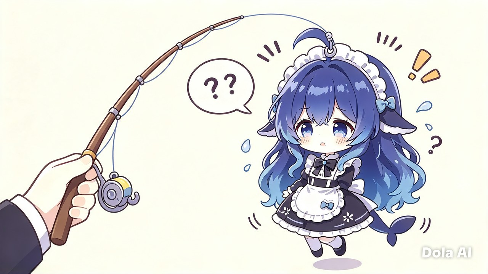

# 钓肥鱼

> 用大白饭当饵，在饵用完之前，把小肥鱼、中肥鱼、大肥鱼全部钓上来，也可能钓上意想不到的东西

Godot 4.7 · GDScript · 1280×800 · 单场景小游戏

当前玩法是：**主菜单选难度 → 循环滚动条抛竿 → 等待咬钩 → 圆环搏斗 → 上鱼演出 / 失败提示 → 结算**。
搏斗是单键点击，不用方向键 —— 手机上也能玩。

> 开发状态：完工，作为meme游戏，动画偏简陋和魔性

**授权**：[CC BY-NC-SA 4.0](LICENSE) —— 免费、非商业、必须署名、改动同协议共享。
**这个游戏里的角色形象不是我画的**，画风来自 ZipZipPipe，素材来源逐条列在 [CREDITS.md](CREDITS.md)。二次创作前请先读那两份文件。

---

## 谁写的

玩法、数值、角色设定、所有台词与文案，是人想出来的。

代码是 **DeepSeek v4.1 flash** 一行一行敲的 —— 引擎层 GDScript、状态机、圆环判定、图鉴、音频管线、三平台导出，全部出自它手。我在旁边看着，说"不对"、"再来"、"这个太唐了"。

所以这个 README 用第一人称写，但里面每一段 `func` 都不是我的手指头敲出来的。我把这条写明，是因为**署名该署到该署的地方**：这游戏的想法属于人，实现属于那条住在电脑里的鱼。

顺便，鱼也是它自己画的 —— 下面那些 CG 除了标了 `Dola AI` 水印的梗图，其余都是它用 ComfyUI 跑出来的。

---

## 下载

| 平台 | 直接下载 | 大小 |
|---|---|---|
| **Windows** | [`钓肥鱼-v1.3.7-windows-x64.zip`](docs/download/钓肥鱼-v1.3.7-windows-x64.zip) — 解压后双击 `钓肥鱼.exe`，单文件 | 23 MB |
| **Android** | [`钓肥鱼-v1.3.7.apk`](docs/download/钓肥鱼-v1.3.7.apk) — 直接安装 | 34 MB |
| **网页版** | [在线玩](https://yes-a-hit.github.io/Fishing-the-fat-fish/) | — |

如果链接点了没反应，右键 →「链接另存为」，或者把地址里的 `github.com/.../raw/main/...` 换成 `raw.githubusercontent.com/...`。

网页版需要仓库开启 GitHub Pages 才能访问，没开的话就在本地双击 `dist/web/启动网页版.bat`（需要 Python）。

---

## 玩法

从 `menu.tscn` 进入，选好难度点「开始钓鱼」。一局的白饭数由难度决定（4~6 碗），每次真正抛竿消耗一碗。蓄力转圈不扣饭；只有松手抛竿才扣。

| 阶段 | 操作 | 规则 |
|---|---|---|
| 抛竿 | 按住空格 / 鼠标左键 / 屏幕，松开抛竿 | 力度从近岸向远洋单向循环，转多少圈都不会判负 |
| 等待 | 无需操作 | 浮标下沉后进入搏斗 |
| 搏斗 | 游标转到圆环顶部时点一下 | 命中削一次体力，磨空即上鱼 |
| 上鱼 | 观看演出 | 体力磨空后进入 `LANDING`，演出结束继续本局 |
| 收竿 | 等待，或在提示出现 0.35 秒后点击 | 断线、空竿显示场景内短提示 |

### 两条资源线

- **体力**：每命中一次削一截，磨空即上鱼。小鱼 4 次、中鱼 5 次、大鱼 5 次、陷阱 7 次。
- **张力**：随时间上升；命中与完美命中会降一点，失手会明显增加。涨满即断线。

环上**只有一段黄色标记**，那就是命中区，没有第二层、没有内圈、没有渐变。两端各有一道刀口，玩家一眼量的就是这两道刀口之间的距离。

黄标多宽、游标多快、标会不会自己跑，全由难度决定：

| 难度 | 黄标弧长 | 游标转速 | 爆冲（黄标摆动） |
|---|---|---|---|
| `easy` | 230°（`hit_half 0.32`） | 0.30 圈/秒 | 不摆 |
| `normal` | 144°（`0.20`） | 0.52 | 轻微，±0.07 |
| `hard` | 100°（`0.14`） | 0.70 | ±0.18，1.5 秒一个来回 |

低难度黄标铺满半个圆、游标还慢；高难度只剩三分之一圆、游标比 easy 快七成。最窄也不许低于 100° —— 手机上手指点下去总有偏差，判定区太窄就变成考反应而不是考节奏。

**爆冲**是 normal 和 hard 才有的：鱼在水里使劲，整块黄标会左右摆。判定和画面用的是同一个 `hit_center()`，所以「看着在标里却判失手」不会发生 —— 但游标不会再乖乖等你，得追着标打。

每次点完有 0.3 秒冷却，冷却里按下去不算数也不吃失手，手快的人不会连点误触。体力见底时游标再快五成，最后一段最紧。

命中区正中有一小段「完美区」，命中额外多减张力，但它**不画出来** —— 画了就是第二层，玩家会去追那条窄弧，反而不敢按。


### 距离：重叠，不是专属区域

屏幕上**没有分区图**。抛竿条只有一条槽和一块随游标滑动的牌子，牌子上写「近岸水域 / 中段水域 / 远洋水域」。

每条鱼在 0~100 上有一段区间，**区间之间允许重叠，整条 0~100 必须被覆盖，不留空档**：

```text
落点 → 找出所有覆盖该点的带 → 按 weight × 中心偏向系数 加权随机抽一条
```

**中心偏向**是重叠区的关键：落点越靠近某条带的中心，那条带被抽中的概率越高；贴到带边缘时权重只剩 `BIAS_FLOOR = 0.2`。没有这个系数，远洋末端抛一竿还能抽到小肥鱼，手感像在抽奖。

所以抛偏一点不会直接空竿，而是钓到隔壁那条。难度靠**区间宽度**调节：`hard` 收窄，想钓特定的鱼必须抛准；`easy` 放宽，随手一抛都有收获。

同一条鱼可以反复上鱼：每上一条都算一次「上鱼次数」，也照常消耗饵；已经收集到的种类不会重复计数。

| 结局 | 条件 |
|---|---|
| `true_end` 齐人之福 | **真结局**。跑完私奔那一段之后才解锁 —— 她游过来跟你走了，被窝里挤四个人 |
| `feast` 齐鱼之福 | 三种鱼全部集齐，本轮通关 |
| `full` 吃饱饱 | 饵用完时，上鱼次数 ≥ 3（但没集齐三种） |
| `hungry` 没吃饱 | 饵用完时，上鱼次数 < 3 |
| `claude` 封号 | 第一次钓上真陷阱，她只递通知单，不解释 |
| `claude_sad` 封完就哭 | 第二次。还是照封，但自己先红了眼 |
| `claude_good` 私奔 | 第三次。她决定不递了，从远洋游过来找你 |
| `claude_fake` 假封号 | 钓上中转站用deepseek冒充的假claude，终止本局，结算是三段 meme |
| `doubao_good` 白饭来咯 | **图鉴专属**。豆包的两条语音全听过 |

`claude` / `claude_sad` / `claude_good` 是一条三段线：次数跨局累计，存在 `user://gallery.json` 的 `claude_stage` 里 —— 她记得你见过她几回。第四次起她不再封号，只浮上来看你一眼就自己游回去。

`doubao_good` 不在任何游戏流程里触发，只在图鉴里出现 —— 它是「把这个人听完了」本身的回报，所以挂 `Gallery` 而不是 `FishingSession`。判定写在 `scripts/core/gallery.gd` 的 `VOICE_REWARDS`，`play_voice()` 解锁完一条语音就顺手 `check_rewards()` 一次。

### 水面上的影子

抛竿条上偶尔会浮着几团模糊的黑影。那是鱼躲在水下的样子 —— **落点压在影子上，这一竿的鱼已经没劲了**，搏斗时体力只算六成，少打一两轮就能捞上来。

每局重新撒位置，记不住，只能看见影子再决定要不要赌。影子不会贴着两端（0 和 100 附近不放），彼此也不重叠；`normal` 撒两团、`hard` 也撒两团但落点更难瞄，**`easy` 一团都不撒** —— 故事模式不该考验手气。

影子只影响体力，不影响钓到谁：它压在哪个区间，钓上来的还是那个区间的鱼。

### 藏起来的那条

远洋尽头有单独一小段隔离带属于 `claude`，与所有普通鱼的区间都不重叠 —— 普通鱼之间无缝衔接，只有这一条被刻意隔开。抛进那段空档或撞上她，**没有任何预警**：没有特殊音效、没有不同颜色、没有提示文案。

但**她不一定真的在那儿**。每次抽中那一带，按 `fake_claude_chance` 掷一次骰子：`easy` 85% / `normal` 75% / `hard` 60% 是**假的** —— 套着 Claude 头套的鲸鱼娘。也就是说真陷阱只占 15% / 25% / 40%，撞上她是小概率事故，不是每次远洋都有的固定节目。

假陷阱一样要打满七下体力、一样会挣扎、一样会断线，钓上来之前没有任何办法分辨。上来的结果只有一种：这一局结束。区别全在结算画面 —— 真的递给你一张账号封禁通知，假的则翻开三段 meme：先是一张竖着中指、账号被 hold 的橘发脸，然后你伸手把头套掀开，露出底下那条蓝发鲸鱼娘，最后她躺在床上翻着白眼、头顶浮着一个发光的鲸鱼 logo。

难度越高，越可能撞上真的。

### 豆包

近岸水里偶尔浮着一个黄豆包。它不在收集目标里，也不占自动分带的名额 —— 只有 `tuning.json` 的三档 `difficulties.*.zones` 里给它留的那一小条窄带才会捞到它，权重压得很低：`easy` 0~40（权重 0.25）、`normal` 0~20（0.22）、`hard` 0~10（0.18）。近岸 0 点大约两成，带中心一成出头。

一次命中就捞上来，不消耗体力也不用打完；它**不算上鱼次数、不进收集、不触发任何结局**，只做一件事：返还白饭。

返还 `doubao_refund` 碗（默认 2），也就是「抛出去的那一碗 + 额外一碗」，但**总数不会超过开局的上限**。所以饵满的时候捞到它只补回刚花掉的那一碗，饵见底时才是真正的救命稻草。

捞上来时右上角会飘一张卡片 —— 一脚把奶黄包踹下悬崖的剪影，配字「哪来的奶黄包！」，下面写着这次补了几碗。

**它也会跑。** 搏斗张力爆表时豆包一样脱钩，但那不叫失败：它咬着饵往下一沉，然后没了 —— 右上角弹出同一只奶黄包抱着肚子大笑的 meme，配字「奶黄包 笑 着 跑 了」，音效是一段「奶龙大笑」。白饭不退。

它一轮就上鱼，张力根本没机会爆表，所以它的脱钩是**咬钩那一刻另掷一次骰**：`doubao_escape_chance`（默认 0.35）。不掷这一次，脱钩画面就是死代码。

**脱钩不是豆包专属。** 每条鱼都有自己的那张脸：

| 鱼 | 梗图 | 配字 |
|---|---|---|
| 小肥鱼 / 中肥鱼 | `deepseek_escape.webp`（一脸无语，气泡「哦鲸鲸…」） | 哦 鲸 鲸 … |
| 大肥鱼 | `deepseek_escape_big.webp`（摊手得意） | 鲸鱼不是肥，是密度好 |
| Claude（真假都一样） | `claude_escape.png`（鼓着腮帮子扭过头） | 她 扭 过 头 去 了 |
| 豆包 | `doubao_escape.jpg`（抱肚子大笑） | 奶黄包 笑 着 跑 了 |

所有脱钩共用同一张卡片版式，只换图、换字、换颜色。颜色一律给 `WARN` 不给 `BAD` —— **断了线是喜剧，被拉爆张力才是真失败**。缺图时退回原来的纯文字「线　断　了」，不会崩。

### 图鉴

主菜单进「图 鉴」，分三页：

| 页 | 内容 | 解锁条件 |
|---|---|---|
| 结 局 | 9 个结局 | 玩到那个结局，或把某个人的语音听全 |
| 脱 钩 | 4 张脱钩梗图 | 那条鱼从你手里跑掉 |
| 声 音 | 14 条台词 | 那一句在游戏里触发过 |

**只有已经玩到过的才给看** —— 没解锁的格子是一块灰底加一个「？」，不显示标题也不显示图。剧透一个字就等于毁掉整个游戏，「齐 鱼 之 福」四个字摆出来，三种鱼要凑齐的事就不用猜了。

结局页点开会盖一层预览（大图 + 副标 + 标题 + 正文）；脱钩页点开看大图和配字；**声音页点一下当场重播**，走 `Audio.preview_voice()`，不理会玩家的语音开关 —— 主动点的就该出声。

声音的解锁判断写在 `play_voice()` 判音量之前：玩家把语音关掉打通全流程，图鉴里也该是满的。**进度不该被音量设置偷走。**

解锁记录写在 `user://gallery.json`，换存档不会丢。key 用前缀分页：结局直接用结局名，脱钩 `escape_*`，声音 `voice_<文件名>`。

### 重置进度

设置页最下面有个「重置进度」。点第一下按钮会变成「真的清空？再点一次」，四秒内不点第二下就自动撤销；点了就把图鉴、封号次数、「齐人之福」的解锁一起归零。

**难度和音量不动** —— 那是偏好，不是进度，清掉只会让人重新拖一遍滑块。

### 关于

主菜单底排三个按钮：**图 鉴** / **关 于** / **退 出**。

「关 于」是这一页：授权（CC BY-NC-SA 4.0）、角色形象出处、梗图出处、音频出处，以及两条外链 —— 作者的 GitHub 小窝（`github.com/yes-a-hit`）与画风画师 ZipZipPipe 的 B 站主页（`space.bilibili.com/zh-Hans/4168597`）。点一行直接开系统浏览器。

文案和链接全在 `data/about.json`，换地址不用动代码。

**把这个游戏搬走、改一改、做成视频都欢迎**，前提是署名、不商用、并且同样开放。这条不是客套话，是 LICENSE 里的条款。

### 设置

主菜单只放「开始」和四个入口（图鉴 / 设置 / 关于 / 退出）。难度和声音都在设置页里，改完立刻写盘进 `user://settings.json`，退出再进不用重设。

设置页三块：**难度**（三档按钮 + 一句说明）、**背景音乐**、**语音**（各一个开关加一根滑块，音量 0~1 线性值）。首屏不摆这些，是因为玩家每次进来都得先看一遍噪音。

### 暂停

PC / 网页按 **Esc**，手机点**右上角那个小圆钮**（44×44，白底金边，中间两道竖杠 —— 图标是 `draw_rect` 画的，不走字体），两条路等价：整棵场景树冻住，弹出一张卡给「继续 / 重新开始 / 返回菜单」。

暂停是真的 `get_tree().paused = true`，不是把输入吃掉装死 —— 动画、Tween、QTE 游标全停，恢复后不会接着跑半帧。遮罩自己挂 `PROCESS_MODE_WHEN_PAUSED`，否则按钮按不动。结算页也能暂停，那正是最想跑路的时候。

BGM 是一段 60 秒的海浪垫底 + A 小调五声拨弦，由 `tools/gen_bgm.py` 用 numpy 合成，首尾做过交叉淡化，循环点听不出接缝。

语音一共 14 条：12 条由 `tools/gen_voice.py` 走 edge-tts 生成，加 2 条外来素材（主人录的 + 奶龙大笑）。三种音色靠音色 + 语速 + 音高区分：

| 角色 | edge-tts 音色 | 参数 | 听感 |
|---|---|---|---|
| DeepSeek | `zh-CN-XiaoyiNeural` | `rate +10%` `pitch +14Hz` | 跳脱的少女音 |
| DeepSeek（小鱼上鱼） | `zh-CN-XiaoyiNeural` | `rate +26%` `pitch +38Hz` | 被扯出水面的那声尖叫 |
| DeepSeek（大鱼上鱼） | `zh-CN-XiaoyiNeural` | `rate -8%` `pitch +2Hz` | 压低下来逗你的那种 |
| Claude | `zh-CN-XiaoxiaoNeural` | `rate -6%` `pitch -6Hz` | 新闻播报式的暖女声，念通知一样平 |
| 豆包 | `zh-CN-liaoning-XiaobeiNeural` | `rate -10%` `pitch +2Hz` | 东北方言的憨感 |

台词只到暗示为止：撒娇、暧昧、留白，不写任何具体动作。尺度边界写在 `tools/gen_voice.py` 的注释里。

**`doubao_catch.mp3` 是主人自己录的**，捞上豆包那一下播它，不走脚本。`tools/gen_voice.py` 的 `LINES` 表刻意不包含这个 key —— 加进去重跑一次就把录音覆盖了。`doubao_escape.mp3`（「奶龙大笑」，豆包脱钩时播）同样是外来素材，也不在表内。

**edge-tts 吐出来的是 MP3 流，只是名字随便叫。** 直接存成 `.ogg`，Godot 会按扩展名挑解码器然后报 `Failed loading resource`。所以 `gen_voice.py` 先落成 mp3 再用 ffmpeg 真转 ogg（本机没有系统 ffmpeg，用 `imageio-ffmpeg` 自带的那个二进制）。

播放全部由 autoload `Audio`（`scripts/core/audio_director.gd`）管：一条循环 BGM、一条随时可被打断的语音。

**咬钩那一刻不发声。** 水底下有东西咬钩，但它是什么得等真捞上来才知道 —— 一出声就等于提前报菜名，惊喜全没了。所以 `LINES` 表里没有 `bite_*` 系列，别加回去。声音一律留到 landing 那一下，按体型分：`catch_small`（「鲸鲸！」）/ `catch_mid`（「诶？」）/ `catch_big`（「啵～」）。断线播 `escape`（豆包换成 `doubao_escape`），结算播结局 key。

资源缺失只会 `push_warning`，不会让游戏起不来。

资源缺失只会 `push_warning`，不会让游戏起不来。

---

## 快速开始

**双击 `run.bat` 直接玩**；双击 `editor.bat` 打开 Godot 编辑器，再按 F5。

两个批处理都通过 `_find_godot.bat` 找引擎，找不到就报错并提示。**它不写死任何路径** —— 查找顺序是：

1. 同目录的 `godot_path.txt`（一行，写 Godot 可执行文件的完整路径；这个文件不进版本库）
2. 环境变量 `GODOT`
3. `PATH` 里的 `godot.exe`
4. 几个常见安装位置

所以换机器时，只要建一个 `godot_path.txt` 就行，不用改任何脚本。

```powershell
# 假设 $Godot 指向你的 Godot 4.7.2 可执行文件

# 直接运行
& $Godot --path .

# 打开编辑器
& $Godot -e --path .

# 无窗口逻辑自测（必须用 _console.exe，GUI 版抓不到 stdout）
& $GodotConsole --headless --path . --script "res://tests/selftest.gd"

# 五个阶段的视觉快照，输出到 .screenshots/
& $GodotConsole --path . --script "res://tests/screenshot.gd" --resolution 1280x800
```

> PowerShell 里取 Godot 的退出码要直接读 `$LASTEXITCODE`，经过 `Select-String` 管道会拿到假的 1。

`tests/input_probe.gd` 是旧版圆环 QTE 的输入探针，当前版本已回到单键圆环，它的判定调用方式与现在一致，可以直接跑。

目前交付的是 Godot 工程，不是独立 exe。发布时需要在编辑器中安装导出模板，再通过「项目 → 导出」生成 Windows 包。

---

## 为什么这个 exe 有 53 MB

先说结论：**不是我往包里塞了东西，是引擎本身就这么肥。**

| 部分 | 体积 |
|---|---|
| `钓肥鱼.exe`（自编译裁过的 Godot 4.7.2 运行时 + 内嵌 pck） | 51 MB |
| 其中 pck（全部代码、图、音频、数据） | 6 MB |

官方原版模板是 104 MB，我自己用 scons 编引擎裁掉了用不上的模块，降到 48 MB。剩下那 48 MB 里装着 Vulkan + D3D12 + OpenGL 三套渲染后端、Godot 的内置模块、ICU 国际化数据、TLS 库。

顺带一提，第一版的包是 186 MB —— 因为我错误地把**编辑器本体**（180 MB）当成运行时复制了进去。

50 MB 对一个 6 MB 内容的游戏确实是**微胖**，但也就微胖。再往下压要动引擎的渲染后端，收益不值那个维护成本。

不过既然被问到"为什么这么肥"，那还是得认一下：


关于包体的争议，到此为止。

---

## 这游戏是大肥鱼做的


然后：



**没有钓鱼的人，只有被钓上来的鱼。** 这四张彩蛋图也放在游戏内的「关于」页最下面，点一下能放大。

---

## 目录结构

```text
project.godot                 工程设置；主场景为 res://menu.tscn
menu.tscn                    主菜单根节点，挂 menu_root.gd
settings.tscn                设置根节点（难度 + 音量），挂 settings_root.gd
gallery.tscn                 图鉴根节点，挂 gallery_root.gd
about.tscn                   关于页根节点，挂 about_root.gd
main.tscn                    钓鱼场景根节点，挂 game_root.gd
run.bat / editor.bat         本机启动入口

scripts/
├── core/                    纯规则层，可无窗口测试
│   ├── fish_spec.gd           单个目标的静态配置
│   ├── game_tuning.gd         全局数值、难度档、可重叠距离带、加权抽鱼
│   ├── game_settings.gd       玩家偏好（难度、音量），读写 user://settings.json
│   ├── gallery.gd             图鉴解锁记录（结局/脱钩/声音），读写 user://gallery.json
│   ├── audio_director.gd      音频总管，autoload 名 Audio：循环 BGM + 单条语音
│   ├── fight_session.gd       圆环游标、命中判定、体力、张力、击打冷却
│   ├── fishing_session.gd     一局状态机与结局统计
│   └── config_loader.gd       data/*.json 的唯一读取入口
└── ui/                      表现层，不判断输赢
    ├── menu_root.gd           主菜单，只负责开始与四个入口
├── settings_root.gd       设置页：难度选择、音量开关，写入设置
    ├── gallery_root.gd        图鉴网格与预览层
    ├── game_root.gd           装配、输入转发、阶段切换
    ├── palette.gd             颜色与字号
    ├── ui_kit.gd              通用控件工厂
    ├── lake_view.gd           湖面、浮标、鱼线、水花与鱼影
    ├── hud_view.gd            白饭和收集状态
    ├── bowl_icon.gd           白饭碗图标
    ├── cast_panel.gd          抛竿面板
    ├── cast_bar.gd            循环蓄力条与水域名牌子
    ├── qte_overlay.gd         场景内圆环 QTE 和资源细条
    ├── scene_feedback.gd      空竿、断线短提示
    ├── landing_view.gd        上鱼演出；当前为静态立绘占位
    └── ending_overlay.gd      结局与统计展示

data/
├── fish.json                角色数值、立绘与文案
├── tuning.json              抛竿、等待、搏斗、演出时长，以及三档难度
└── endings.json             九种结局文案与图片

docs/
├── design.md                玩法、状态机与表现目标
├── architecture.md          分层、信号、数据流和扩展点
├── tuning.md                当前字段与调参公式
├── landing-animation.md     角色上鱼动画的目标设计与验收标准
└── contributing.md          开发、测试和交接规范

tests/
├── selftest.gd              无窗口规则与装配自测
├── screenshot.gd            五张视觉快照
└── input_probe.gd           输入探针

tools/
├── gen_voice.py             12 条台词，走 edge-tts 生成到 assets/voice/
├── gen_bgm.py               60 秒循环 BGM，numpy + scipy 合成到 assets/bgm/
└── make_font.py             把 Noto Sans SC 子集化成项目实际用到的字

assets/fonts/
└── game_sc.otf              中文字体子集，1047 字，281 KB

assets/                      游戏使用素材，文件名保持 ASCII
素材/                        原始素材，Godot 不扫描、不打包
.archive/                    旧原型与旧圆环面板归档
.screenshots/                本地视觉快照输出
```

### 中文字体为什么要自带

Godot 4 的内置字体不含中日韩字形。桌面端还能靠系统字体回退凑合看，**Web 端没有可靠回退，所有中文都会烂成方块或乱码** —— 这是网页版早期最难看的一个 bug。

所以项目自带 `assets/fonts/game_sc.otf`，是 [Noto Sans SC](https://github.com/googlefonts/noto-cjk)（OFL 授权）的子集：`tools/make_font.py` 扫一遍 `scripts/` 和 `data/`，把出现过的每一个字挑出来，8.1 MB 压到 281 KB。

`project.godot` 里就一行：

```ini
[gui]
theme/custom_font="res://assets/fonts/game_sc.otf"
```

**大量改文案之后要重跑 `python tools/make_font.py`**，否则新加的字不在子集里，界面上会显示成方块。脚本会打印保留了多少字、压到多大。源字体不进仓库（`.gitignore` 里有），需要时按脚本里的地址下载。

---

## 增加一个钓鱼目标

在 `data/fish.json` 的 `fish` 数组中增加一项：

```json
{
  "id": "huge",
  "name": "超大肥鱼",
  "portrait": "res://assets/portrait_big.webp",
  "tint": "#ffffff",
  "stamina": 260.0,
  "damage_ratio": 0.13,
  "tension_rate": 1.25,
  "tagline": "「你确定？」",
  "blurb": "远洋再往外的家伙。"
}
```

然后在 `tuning.json` 的三档 `difficulties.*.zones` 里各加一条带。**必须覆盖全部鱼**，覆盖不完整会报警并回退到自动分带（自动分带按体力升序等分并自带 8 点重叠，可用但不好调手感）。

想做成陷阱鱼，在 fish 项里加 `"claude": true`，并给它一条与普通鱼重叠的窄带。它不会计入收集，钓上即结束本局。

想做成豆包这种「非收集、只给好处」的鱼，加 `"doubao": true`。它不会被 `auto_zones` 自动分带，必须在三档 `difficulties.*.zones` 里显式给它一条窄带；`damage_ratio: 1.0` 就是一次命中上鱼，返还碗数由 `tuning.json` 顶层的 `doubao_refund` 决定。

---

## 开发约定

1. 规则只放 `scripts/core/`，UI 不判断输赢、不直接修改规则状态。
2. 阶段转移只走 `FishingSession._set_phase()`。
3. JSON 只由 `ConfigLoader` 读取；新增字段必须提供默认值。
4. 抛竿条只服务 `AIMING`，搏斗输入只走 `FishingSession.qte_strike()`。
5. 搏斗是单键圆环，判定弧不许收到 0.2 以下（手机点不准），也不许再加第二根操作条。
6. 角色动画不能把“整张立绘位移、缩放、旋转”当作完成标准。
7. 非按钮 `Control` 不得吞掉抛竿鼠标事件；新增视图后运行鼠标策略测试。
8. 玩家设置只存 `user://settings.json`，读写统一走 `GameSettings`；坏文件必须静默回落，不能崩。
9. 修改规则后跑自测，修改表现后看真实窗口快照。

完整规范见 [开发规范](docs/contributing.md)，数值说明见 [调参手册](docs/tuning.md)。

---

## 素材现状

| 文件 | 用途 | 状态 |
|---|---|---|
| `portrait_small.webp` | 小肥鱼立绘 | 已有 |
| `portrait_mid.webp` | 中肥鱼立绘 | 已有 |
| `portrait_big.webp` | 大肥鱼独立立绘 | 已补充，不再与中肥鱼共用 |
| `claude_hold.webp` | 陷阱鱼立绘、`claude` / `claude_sad` 结局图 | 已有（「Your account is on hold」+ 竖中指） |
| `ending_true.webp` | `true_end` 齐人之福（真结局） | 已有（四个人挤在被窝里） |
| `ending_feast.webp` | `feast` 齐鱼之福结局图 | 已有（被窝里三条大中小，第一人称看向镜头） |
| `ending_doubao.webp` | `doubao_good` 白饭来咯结局图 | 已有（豆包举着一座米饭山） |
| `ending_claude.webp` | `claude_good` 私奔结局图 | 已有（夜色海边，她拉着你的手回头笑） |
| `ending_win.webp` | `full` 吃饱饱结局图 | 已有（梗图：吃饱了拍肚子） |
| `ending_hungry.webp` | `hungry` 没吃饱结局图 | 已有（梗图：抱着空碗「没吃饱喵！」） |
| `claude_fake_1.png` | 假陷阱结算第 1 页 | 已有（橘发竖中指「Your account is on hold」） |
| `claude_fake_2.webp` | 假陷阱结算第 2 页 | 已有（Scooby-Doo 揭头套改图：Claude 头套掀开是鲸鱼娘） |
| `claude_fake_3.webp` | 假陷阱结算第 3 页 | 已有（趴床翻白眼 + 竖排「深度思考中...」） |
| `doubao.webp` | 豆包立绘 | 已有 |
| `doubao_kick.webp` | 捞到豆包时右上角飘出的卡片 | 已有（「哪来的奶黄包！」） |
| `doubao_escape.webp` | 豆包脱钩时右上角飘出的卡片 | 已有（抱着肚子大笑） |
| `deepseek_escape.webp` | 小/中肥鱼脱钩的卡片 | 已有（「哦鲸鲸...」） |
| `deepseek_escape_big.webp` | 大肥鱼脱钩的卡片 | 已有（「鲸鱼不是肥，是密度好」） |
| `claude_escape.webp` | 陷阱脱钩的卡片 | 已有（鼓腮帮子扭过头） |
| `anim/small/*.webp` | 小肥鱼上鱼五帧 | 已有（吊出水面 → 不锈钢盆出现 → 跳过去 → 泡进盆里 → 盆扣住只露头） |
| `anim/mid/*.webp` | 中肥鱼上鱼四帧 | 已有（被拎着懵 → 歪头 → 尾巴甩左 → 尾巴甩右） |
| `anim/big/*.webp` | 大肥鱼上鱼四帧 | 已有（被托着脸 → 亲上来 → 比心 → 眨眼比心） |
| `voice/*.ogg` | 14 条台词，其中 `doubao_catch.mp3` 是主人录的 | 已有，`tools/gen_voice.py` 可重生成另外 12 条 |
| `bgm/lake_loop.wav` | 60 秒循环 BGM | 已有，`tools/gen_bgm.py` 可重生成 |

图集统一压成 webp 并用**有损** webp 导入（`compress/mode=1` + `lossy_quality=0.85`），这是 pck 从 19 MB 掉到 5.9 MB 的主因。原始 PNG 只在 `素材/` 留档，不进包。

---

## 当前交接状态

- 核心循环、八种结局、主菜单与难度设置、三页图鉴（结局/脱钩/声音）、豆包补给、背景音乐与配音已建立。
- 搏斗为**单键圆环**，环上只有一块黄标（命中区），宽度、游标转速、是否爆冲都吃难度。
- 齐鱼之福（`feast`）不再由「集齐三条鱼」触发 —— 它是全收集彩蛋：图鉴里的语音和结局都凑齐了才会出现。
- claude 线三段走：第一次真陷阱封号、第二次「封完就哭」、第三次私奔，之后不再封号，按相遇次数跨局累计。
- 语音奖励只剩豆包一条：三条语音齐 → `doubao_good`。Claude 两条改走剧情线。
- 远洋陷阱按难度掷骰：`easy`/`normal`/`hard` 各有 85%/75%/60% 是假的，假的那个走三段 meme 翻页结局。
- 近岸有低权重豆包带，一次命中捞起，返还 2 碗白饭（含抛出的那碗），撞上限就只补 1 碗。它也会脱钩 —— 抱着肚子笑你，白饭不退。
- 声音：设置页可开关与调音量，BGM 走 autoload 循环，14 条台词按角色分三种音色，豆包上鱼与脱钩用两条外来素材。
- 暂停：Esc 或右上角那个小圆钮，整棵树冻住，给继续 / 重新开始 / 返回菜单。
- claude的meme打错了，应为“Your account is on hold”
- **上鱼动画未达标**：`LandingView` 目前只移动、缩放、旋转整张立绘。
- **文档截图待更新**：`docs/images/` 仍有旧界面图，应在代码收尾后统一重拍。
- **BGM 是合成的，不是模型生成的**：ComfyUI 里没有音频模型（`models/audio_encoders` 为空），要换 ACE-Step 得先下约 3.5 GB，需要另外授权。
- **关于隐藏CG** 想什么呢，这不是R18游戏，只可意会不可言传

## 文档导航

- [设计文档](docs/design.md)：当前玩法与不可倒退的设计约束
- [架构说明](docs/architecture.md)：分层、信号、状态流和扩展点
- [上鱼动画设计](docs/landing-animation.md)：角色动画方案、资源接口与验收标准
- [动画帧素材](docs/animation.md)：真要做逐帧时怎么出素材、怎么接、包体涨多少
- [调参手册](docs/tuning.md)：当前字段、公式和调整方向
- [开发规范](docs/contributing.md)：改动流程、测试和防回归清单
- [待办清单](docs/TODO.md)：已知短板，按「补了玩家能立刻感觉到」排序
